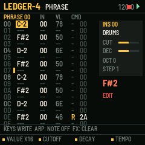
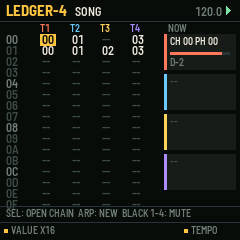
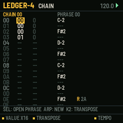
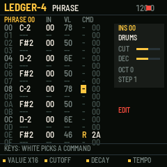

# LEDGER-4

A tracker for the M-VAVE FM-1. One of six sequencer firmwares built from a survey of sequencer archetypes (see the companion survey). Built on fm1-base; makes its own sound and sends MIDI.

## What it is for

**Archetype:** Tracker (hierarchical reuse): Little Sound DJ, the Dirtywave M8, Renoise.

LEDGER-4 brings the tracker's way of writing music to the FM-1: notes as rows of text, read top to
bottom, with a command on each row that says *how* the note plays. Its aim is depth from very little: a phrase of 16
rows is reused by reference in chains (with a transpose each time), and chains are laid out in a song, so a whole
track is a few hundred bytes of numbers that can be edited precisely and repeated without copying. The commands
(arpeggio, chance, delay, kill, retrigger, slide, tempo, hop, filter, MIDI CC, random, groove, echo) give every row
the micro-control that a step grid hides behind menus.

## What it does

- SONG: 64 rows x 4 tracks of chain numbers; each track walks its own column, so blocks of different lengths drift.
- CHAIN: 16 rows of phrase + transpose. PHRASE: 16 rows of NOTE, INSTRUMENT, VELOCITY, COMMAND, VALUE.
- 13 commands, explained in words on the line under the grid as the cursor lands on them.
- Grooves as two tick counts (6/6 straight, 7/5 swung), per row, as in LSDJ.
- 16 instruments: synth, drums (notes pick the sound) or MIDI only, each with its MIDI channel and a CC for the M command.
- The keys write notes at the cursor and advance; in number columns the 16 white keys type hex digits 0..F; in the command column they pick the command.
- SEL dives into what is under the cursor; ARP makes a new chain/phrase (or a note off); copy and paste; transpose a phrase.

## The controls

Hold any button alone for a second for its help card on the screen.

| Control | What it does |
| --- | --- |
| HOME / SEQ / EDIT / ENV / GLO | SONG / CHAIN / PHRASE / INSTRUMENT / PROJECT pages |
| SELECT / ALGO | cursor row / column |
| PRESETS / K1 | the value under the cursor, by 1 / by 16 (or an octave) |
| K2, K3 (phrase) | the row's instrument: cutoff, decay, live |
| K4 | tempo |
| keys | note column: write a note and advance; number columns: white keys are hex 0..F |
| SEL tap | go into the chain / phrase / instrument under the cursor (made if empty) |
| ARP | the next unused chain or phrase; a note off in the note column |
| FX | clear the cell |
| SEL + LFO / LFO | copy / paste the chain or phrase |
| SEL + PRESETS | transpose the phrase |
| REC | edit on / off (off: the keys only listen) |
| PLAY | song from the cursor row; on CHAIN or PHRASE, loop what is shown |
| black keys 1-4 (SONG) | mute tracks |

Common to all six: PLAY starts and stops, SAVE saves to the project slot, OCT- / OCT+ the octave.

## Screens

   

## Build, test, install

The firmware is built with [fm1-base](https://github.com/charlesvestal/fm1-base) (vendored in `base/`) and JieLi's
toolchain, which runs in Docker on macOS (`colima start` first). Python 3.11 with Pillow.

    ./build.sh --host              # the host simulator, then every test in app/tests/
    ./build.sh --shots             # the screenshots in app/docs/img/
    ./build.sh                     # a development package: app/build/ledger-4.fwsc
    ./build.sh --release 0.1       # a release package: app/build/ledger-4-0.1.fwsc

Install over USB with fm1-base's installer (the FM-1 connected, Python with `python-rtmidi`):

    python3.11 base/tools/fm1_install.py app/build/ledger-4-0.1.fwsc

Keep M-VAVE's stock firmware and M-UPGRADE at hand: the installer can put the stock firmware back.

## Layout

| Path | What |
| --- | --- |
| `app/seq.c` | the sequencer: its data and the engine (runs inside the audio render, sample-exact) |
| `app/ui.c` | the controls and the screen |
| `app/app.c`, `app/app.h` | the contract with fm1-base |
| `app/core/` | shared with the five sibling firmwares: synth (8 voices, 11 drums, echo), transport and MIDI clock, project slots, controls kit, text |
| `app/tests/` | host-simulator scripts: `basic.txt` (behaviour) and `screens.txt` (pictures) |
| `app/fm1.toml` | build settings, package identity `FM-1_21`, firmware.json fields |
| `base/` | fm1-base and felucca-bsp, vendored (MPL-2.0) |

## Common to all six

- Its own sound: an 8-voice synth (saw, square, triangle, sine, noise, super-saw; resonant filter; ADSR; glide),
  eleven synthesised drums on General MIDI notes, and a shared echo. Every part also goes out as MIDI (its channel set
  on its sound page) over USB and Bluetooth MIDI.
- MIDI clock: INTERNAL (and send clock, start, stop) or FOLLOW an incoming clock. MIDI notes in play the part shown.
- Four project slots (SETUP / GLO page). SAVE while playing saves at the stop.
- Hold any button alone for a second: a help card explains it.

## Status

**0.1, untested on hardware.** It builds for the FM-1, passes its host-simulator tests, and its screens are taken
from the simulator. Nothing has been run on a real FM-1 yet; CPU load of the synth on the device is not measured.

## Licence

MPL-2.0, as fm1-base. After Little Sound DJ (Johan Kotlinski) and the Dirtywave M8.
