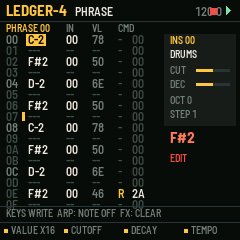
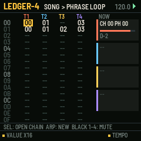
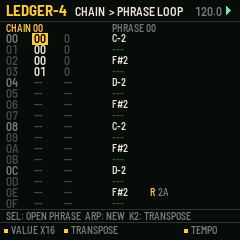
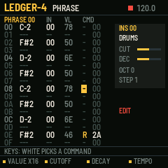

# LEDGER-4

A tracker for the M-VAVE FM-1. One of six sequencer firmwares built from a survey of sequencer archetypes (see the companion survey). Built on fm1-base; makes its own sound and sends MIDI.

## What it is for

**Archetype:** Tracker (hierarchical reuse): Little Sound DJ, the Dirtywave M8, Renoise.

LEDGER-4 brings the tracker's way of writing music to the FM-1: notes as rows of text, read top to
bottom, with a command on each row that says *how* the note plays. Its aim is depth from very little: a phrase of 16
rows is reused by reference in chains (with a transpose each time), and chains are laid out in a song, so a whole
track is a few hundred bytes of numbers that can be edited precisely and repeated without copying. The commands
(arpeggio, chance, delay, kill, retrigger, slide, tempo, hop, filter, MIDI CC, random, groove, echo) give every row
the micro-control that a step grid hides behind menus.

## What it does

- SONG: 64 rows x 4 tracks of chain numbers; each track walks its own column, so blocks of different lengths drift.
- CHAIN: 16 rows of phrase + transpose. PHRASE: 16 rows of NOTE, INSTRUMENT, VELOCITY, COMMAND, VALUE.
- 13 commands, explained in words on the line under the grid as the cursor lands on them.
- Grooves as two tick counts (6/6 straight, 7/5 swung), per row, as in LSDJ.
- 16 instruments: synth, drums (notes pick the sound) or MIDI only, each with its MIDI channel and a CC for the M command.
- The keys write notes at the cursor and advance; in number columns the 16 white keys type hex digits 0..F; in the command column they pick the command.
- SEL dives into what is under the cursor; ARP makes a new chain/phrase (or a note off); copy and paste; transpose a phrase.

## The controls

Hold any button alone for a second for its help card on the screen.

| Control | What it does |
| --- | --- |
| HOME / SEQ / EDIT / ENV / GLO | SONG / CHAIN / PHRASE / INSTRUMENT / PROJECT pages |
| SELECT / ALGO | cursor row / column |
| PRESETS / K1 | the value under the cursor, by 1 / by 16 (or an octave) |
| K2, K3 (phrase) | the row's instrument: cutoff, decay, live |
| K4 | tempo |
| keys | note column: write a note and advance; number columns: white keys are hex 0..F |
| SEL tap | go into the chain / phrase / instrument under the cursor (made if empty) |
| ARP | the next unused chain or phrase; a note off in the note column |
| FX | clear the cell |
| SEL + LFO / LFO | copy / paste the chain or phrase |
| SEL + PRESETS | transpose the phrase |
| REC | edit on / off (off: the keys only listen) |
| PLAY | song from the cursor row; on CHAIN or PHRASE, loop what is shown |
| black keys 1-4 (SONG) | mute tracks |

Common to all six: PLAY starts and stops, SAVE saves to the project slot, OCT- / OCT+ the octave.

## Screens

## Install

Use the [installer page](../install/) in Chrome or Edge with the FM-1 connected by USB. Keep M-VAVE's stock firmware
and M-UPGRADE at hand: the installer can put it back. To build it yourself, see the
[source](https://github.com/davidpryan/ledger-4).

## Status

0.1, untested on hardware. It builds for the FM-1 and passes its host-simulator tests; nothing has been run on a real
FM-1 yet.
